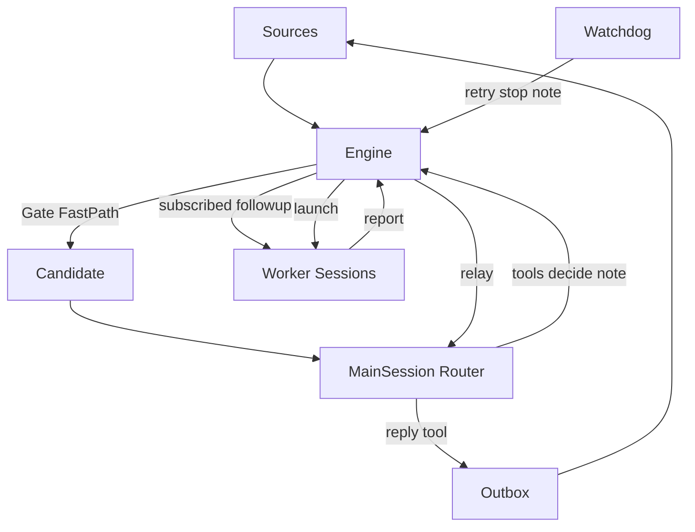

# 设计

对齐微信文 *Super-agent 设计探索* 与 [dsh-superagent-prototype](https://github.com/deepseek-ai/dsh-superagent-prototype) 的主路径：常驻 **Main Session（Router）** 路由并对外说话；**Worker** 隔离执行；**Watchdog** 外部巡检。本仓库是研究用本地 demo，不绑 DeepSeek Harness、不上云。

## 0. 理念

**占用尽量少的人类注意力，交付尽量多的价值。**

- 只在被请求、或规则允许时行动；主动工作默认 observe（会接但不真建单）。
- 只在有人必须行动或能用上结果时说话；Worker 从不直接对人说。
- 用户面对的始终是同一个 Agent；Session 是实现细节。

## 1. 双层架构（文章 §2）

| 层 | 职责 | 代码 |
| --- | --- | --- |
| **Router（Main Session）** | 常驻全局序点：接候选、分派、收 Worker 汇报、统一对外说话；不执行具体任务 | `src/router/` |
| **Worker** | 每 Ticket 独立上下文与 worktree；只写结构化 report | `src/executor/` |
| **Watchdog** | 主系统外的 Control Loop：巡检卡住工单，可 retry / note | `src/watchdog/` |

Router 工具（精简自原型 `orchestrator_*`）：`read` · `eval_decide` · `reply` · `ticket_note` · `ticket_retry` · `ticket_request_status` · `trigger_requeue`。写操作一律经 Engine。

- `router.agent: mock`：确定性工具调用（测骨架 / CI）。
- `router.agent: claude`：真 `claude -p`，模型输出 JSON `actions`，宿主执行 `orchestrator_*`（简陋 tool bridge；失败回退 mock）。
- Worker：`executor.agent: mock | claude | codex`。`npm run demo:real` 两边都走 claude。

## 2. 事件驱动（文章 §3）

| 概念 | 含义 |
| --- | --- |
| Trigger / Thread | 环境事件与同一话题上的事件流 |
| Gate（程序 Fast Path） | 名单、admission、explicit/inferred；滤噪后再进 Router |
| Eval | 一批 Trigger 的冷启动判断；交 Main Session |
| Mandate / Ticket | 不可变授权与工作单元 |
| Subscription（路由 Fast Path） | 已归属 Ticket 的跟进直通 Worker，不再经 Router 工具转发；Router 此时只能 stop |
| observe | inferred 肯定结果记 `would_accept`，不建单 |

Inline & Spill / 链式召回：Worker 提示词内联工单与消息卡片，长内容 spill 到 `context/`。

## 3. 对外说话（C1）

Worker `report.reply` / `question` **不**直接进 Outbox；Engine 发 relay → Main Session → `orchestrator_reply` → Outbox。

- 默认 `outbound: auto`：Router 说完即发。
- `outbound: review`：仍可开草稿批准（调试用），面板次要路径。
- Pull request 提案仍由宿主从 report 入 Outbox（开 PR 是宿主能力）；链接可由 Router/宿主宣布。

## 4. 异步味道（文章 §4 示意）

Router 一回合串行处理 inbox 批；回合期间新 Trigger / report 只入队，结束后再喂。Ingest 从不被 Router turn 阻塞。不实现 Harness 级异步 `start()`/`stop()` 工具原语。

## 5. 存算分离（文章 §5 示意）

| 脑与状态 | 手 |
| --- | --- |
| Engine + SQLite + Router inbox | Executor worktree + CLI agent |

不上云、无端侧 daemon；边界画清即可。

## 6. Watchdog（文章 §6）

定时（默认 60s）巡检：`canRetry` 的工单自动 `retryTicket` + note，并给 Main Session 一条巡检通知。面板可「立即巡检」。

## 7. 与原文 / 原型的差

| 文章或原型 | 本仓库 |
| --- | --- |
| DeepSeek Harness 常驻 Session | Node + SQLite + `claude` CLI（非官方 Harness） |
| Router 原生 tool-use Session | `router.agent=claude`：JSON `actions` 工具桥；`mock` 供离线 CI |
| Worker 强模型 Session | `executor.agent=claude|codex|mock` + worktree |
| 云端 Loop + 端侧 daemon | 本地单进程示意（§5） |
| 异步 ReAct start/stop | inbox 批处理示意（§4） |
| Outbox 可直接发 | 默认 `outbound: auto`（C1）；可选 `review` |

领域模型（Trigger / Thread / Eval / Mandate / Ticket / Fast·Slow）与原型一致，刻意保留。

## 8. 代码地图（解题 vs 调度）

| 角色 | 路径 |
| --- | --- |
| 被修的 demo 业务代码 | `scripts/demo-repo.ts` → `examples/demo-repo` |
| 真正干活（Worker） | `src/executor/` + `prompts/worker.md` |
| 路由与对外说话（Router） | `src/router/` + `prompts/router.md` |
| 领域与授权 | `src/core/`、`src/policy.ts` |
| 巡检 | `src/watchdog/` |

离线：`npm run demo`。真 Claude：`npm run demo:real`（需本机已登录 `claude`）。
