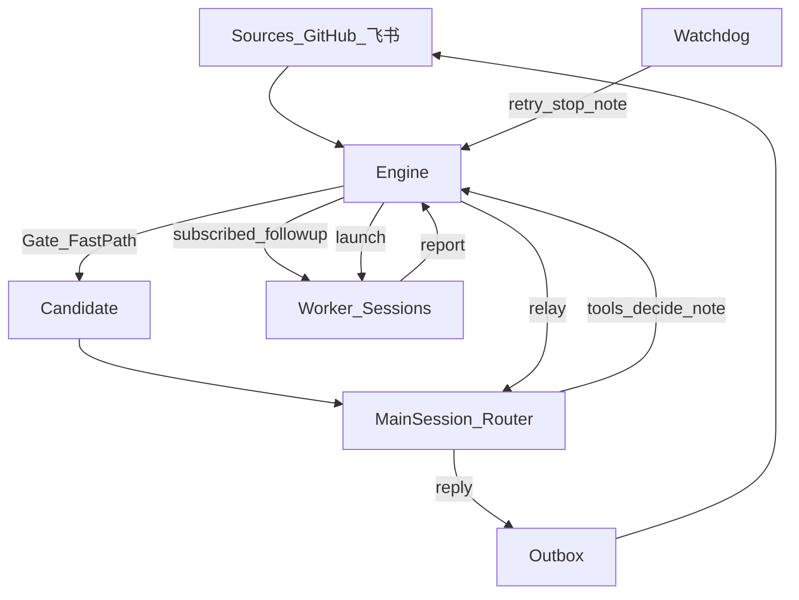

# 设计

对齐微信文 [Super-agent 设计探索](https://mp.weixin.qq.com/s/zoS7GlReWPhfCjENGxXCdg) 与 [dsh-superagent-prototype](https://github.com/deepseek-ai/dsh-superagent-prototype) 的**主路径**：常驻 Main Session（Router）路由并对外说话；Worker 隔离执行；Watchdog 外部巡检。

本仓库是**研究用本地 demo**：不绑 DeepSeek Harness、不上云。宿主 = Node + SQLite +（可选）`claude` CLI。

阅读顺序：理念 → 双层 → 领域词 → 一条请求怎么走 → 策略 → 实现取舍 → 代码地图。  
动手逐步对照见 [walkthrough.md](walkthrough.md)。

---

## 0. 理念

**占用尽量少的人类注意力，交付尽量多的价值。**

对系统的要求：

1. **少动**：只在被明确呼叫，或团队写下的规则允许时行动；主动工作默认 `observe`（会判断「本会接」，但不真建单）。
2. **少说**：只在有人必须行动、或能用上结果时说话；确认一次，干活时安静，有结果 / 要决定 / 做不完时再说。
3. **一个面孔**：人面对的始终是同一个 Agent；底下多少 Session / Ticket 是实现细节。
4. **按影响停**：局部改动做到可评审为止；需要产品/设计决定就停下问一句。

文章把这种形态叫 Super-agent：连续、高效、主动、持久。单 Session ReAct 做不到，所以拆双层 + 事件驱动。

---

## 1. 双层架构（文章 §2）

### 为什么拆

| 做法 | 连续 | 吞吐 | 问题 |
| --- | --- | --- | --- |
| 所有事件进同一个 Session | 高 | 低 | 串行阻塞、上下文搅在一起 |
| 每条事件新开 Session | 低 | 高 | 无全局记忆、多人乱回帖 |

折中：**Router 保连续与分派；Worker 保隔离并发。**

| 层 | 职责 | 禁止 | 代码 |
| --- | --- | --- | --- |
| **Router（Main Session）** | 全局序点：看候选、接单/忽略/停止、收 Worker 汇报、**统一对外说话** | 不改业务代码、不配 Bash 干活 | `src/router/` |
| **Worker** | 一 Ticket 一上下文 + worktree；工具执行；只写结构化 **report** | 不直接对人说话、不开 PR、不 `git push` | `src/executor/` |
| **Watchdog** | 主系统外的 Control Loop：卡住则 retry / note | 不接新业务需求 | `src/watchdog/` |

### Router 怎么「真」跑（本仓库）

| `router.agent` | 行为 |
| --- | --- |
| `mock` | 确定性：命令解析接单、report 原样转发。测骨架 / CI |
| `claude` | `claude -p --tools ''` + `prompts/router.md` → JSON `actions` → 宿主执行 `orchestrator_*`；失败回退 mock |

工具（写操作一律经 Engine）：`orchestrator_read` · `orchestrator_eval_decide` · `orchestrator_reply` · `orchestrator_ticket_note` · `orchestrator_ticket_retry` · `orchestrator_ticket_request_status` · `orchestrator_trigger_requeue`。

Worker：`executor.agent = mock | claude | codex`。`npm run demo:real` = 两边都 `claude`。

---

## 2. 领域模型（文章 §3 前半）

| 概念 | 一句话 | 例子 |
| --- | --- | --- |
| **Source** | 一种事件入口 | GitHub / GitLab / 飞书 |
| **Trigger** | 一条不可变事件 | 一条 Issue 评论 |
| **Thread** | 同一话题上的 Trigger 流 | `github:issue:12`、飞书话题 |
| **Gate** | 程序 Fast Path：名单、是否 @、admission | 陌生人 → ignore |
| **Eval** | 一批待判 Trigger；同一 Thread 同时最多一个 | 交 Router 冷启动 |
| **Decision** | accept / ignore / stop / unavailable | 带理由与审计 |
| **Mandate** | accept 授予的不可变授权 | strength、scope、read/write、策略版本 |
| **Ticket** | 一个被授权的工作单元 | 状态机独立于 Worker 进程 |
| **Assignment** | Ticket 与一次执行的绑定 | 可重试、可换新 Assignment |
| **Subscription** | Ticket ↔ Thread 多对多 | 跟进走 Fast Path 直通 Worker |
| **Outbox** | 所有外部写的唯一出口 | 回帖、提问、开 PR |

**人不是领域对象。** 允许列表按每个 Source 自己的身份；GitHub login 与飞书 open_id 互不映射。

### Fast Path / Slow Path

1. **Gate（程序）**：大部分噪音直接 ignore，不进模型。
2. **Eval → Router（慢路径）**：只有候选才让 Main Session 决定是否建 Ticket。
3. **订阅直通（路由 Fast Path）**：Ticket 已订阅的 Thread 上，后续人类消息**直达 Worker**，不再经 Router 工具转发；Router 此时**只能 stop**，不能再「接一张新单」抢走跟进（除非 Worker **交还**）。

### observe / auto / off

| `policy.mode` | 对 **inferred**（未 @ 但像活） |
| --- | --- |
| `off` | 一律不接 |
| `observe`（默认） | 研判可「会接」，记 `would_accept`，**不建 Ticket** |
| `auto` | 研判肯定且命中规则才真接单 |

**显式请求**（`/agent` / @）在任何模式下都可接。

### 交还（hand-back）

只读 Ticket 上有人说「帮我改代码」→ Worker 在 report 里 `handbacks` → 消息回到 Eval → Router 可建**新的可写** Ticket。Mandate 不可变：要更大权限 = 新工单。

---

## 3. 一条请求怎么走

以「alice 在 Issue #12 写 `/agent summarize …`」为例（`outbound: auto`）：

1. Source 把 webhook 译成 **Trigger**，挂在 Thread `github:issue:12`。
2. Engine **receive**：无订阅所有者 → 进入 Thread pending。
3. **evaluateDue** 开 **Eval**；Gate 判 explicit → 候选进 Router inbox。
4. Router（mock 或 claude）调 `orchestrator_eval_decide(accept)` → 建 **Ticket** + Mandate(read) + Assignment；再 `orchestrator_reply(acknowledgement)`。
5. Executor **launch**：worktree `superagent/<name>`，跑 Worker 一回合。
6. Worker 结尾 JSON **report**（含 `reply`）；Engine **不**直接发帖，只 **relay** 给 Router。
7. Router `orchestrator_reply(result)` → Outbox → Source 回帖（auto 则立刻发）。
8. report `ready` 且无待跟 PR → Ticket **completed**。

跟进要求修复、observe、陌生人：见 [walkthrough.md](walkthrough.md)。

---

## 4. 对外说话（C1）

| 谁 | 能不能直接对人说 |
| --- | --- |
| Worker | **否**。只写 report 字段 |
| Router | **是**。唯一日常说话者 |
| 宿主 | 开 PR（凭据不进 Worker）；PR 链接可再发一条 |

- 默认 `outbound: auto`：Router 说完即发。
- `outbound: review`：先进草稿，面板批准（调试用）。
- Worker 提了 `pull_request`：宿主入 Outbox 开 draft PR；Worker 应把 `reply` 留空，避免抢在 PR 存在前宣布。

---

## 5. 异步与存算（文章 §4–§5 示意）

**§4：** Router 一回合串行处理 inbox；回合中新 Trigger/report 只入队，不阻塞 ingest。不实现 Harness 的异步 `start()`/`stop()` 工具原语。

**§5：**

| 脑与状态 | 手 |
| --- | --- |
| Engine + SQLite + Router inbox | Executor worktree + CLI |

不上云、无端侧 daemon。

---

## 6. Watchdog（文章 §6）

- 默认约 60s 巡检；面板可「立即巡检」。
- `canRetry` 的工单：`retryTicket` + note，并通知 Main Session。
- 目的：进程还在但任务僵死时，有外部回路介入。

---

## 7. 与原文 / DeepSeek Harness 的差

**DeepSeek Harness** = 他们的 Agent 运行时（Session、原生工具、后台 job、产品壳）。原文 Super-agent 默认跑在那上面。

| 文章或原型 | 本仓库 |
| --- | --- |
| Harness 常驻 Session | Node + SQLite + `claude` CLI |
| Router 原生 tool-use | JSON `actions` 工具桥（简陋）；可 mock |
| Worker Harness Session | CLI + worktree；可 mock |
| 云端 Loop + 端侧 daemon | 本地单进程示意 |
| 异步 ReAct start/stop | inbox 批处理示意 |

**刻意对齐的：** Trigger / Thread / Eval / Mandate / Ticket / Gate / 订阅 Fast Path / observe / hand-back / Worker 不直接对人说。

---

## 8. 代码地图

| 角色 | 路径 |
| --- | --- |
| 被修的 demo 业务代码 | `scripts/demo-repo.ts` → `examples/demo-repo/` |
| 真正干活 | `src/executor/` + `prompts/worker.md`（mock 时看 `mock-agent.ts`） |
| 路由与对外说话 | `src/router/` + `prompts/router.md` |
| 领域唯一写者 | `src/core/engine.ts` |
| Gate / observe | `src/policy.ts` |
| 来源 | `src/sources/` |
| 持久化 / Outbox | `src/store/` |
| 巡检 | `src/watchdog/` |
| 面板 | `src/panel/` + `src/app/views.ts` |

离线：`npm run demo`。真 Claude：`npm run demo:real`。
